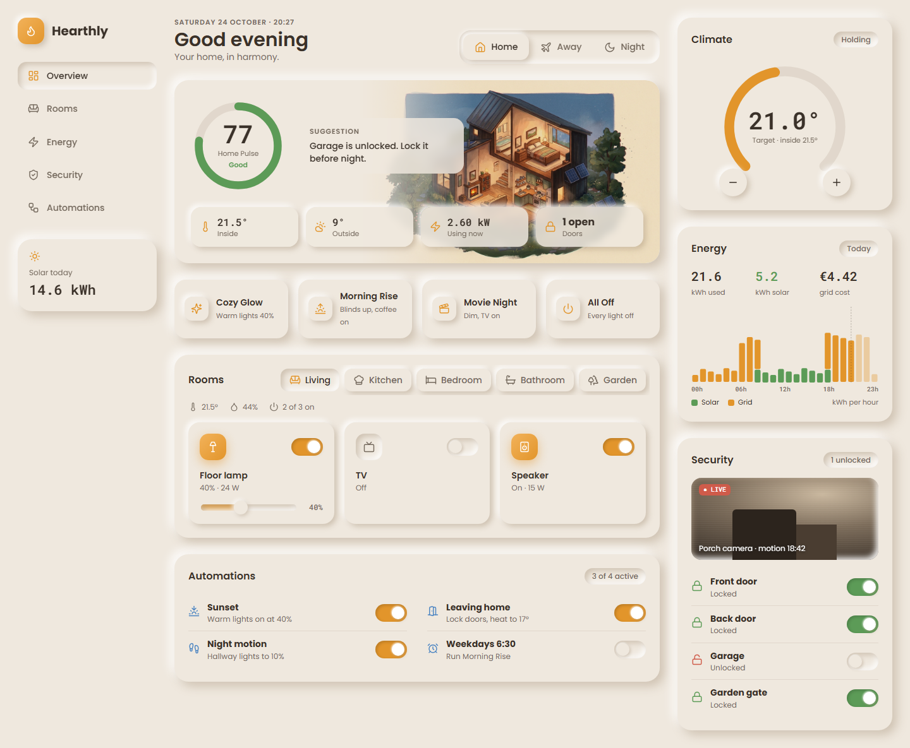
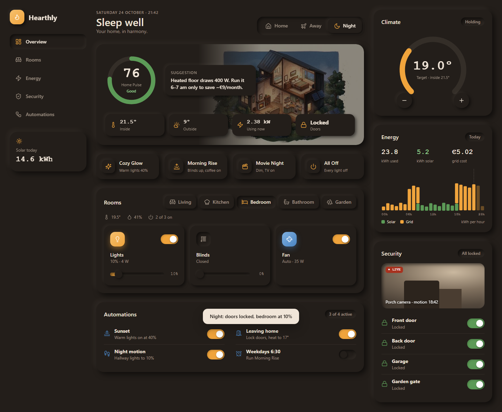
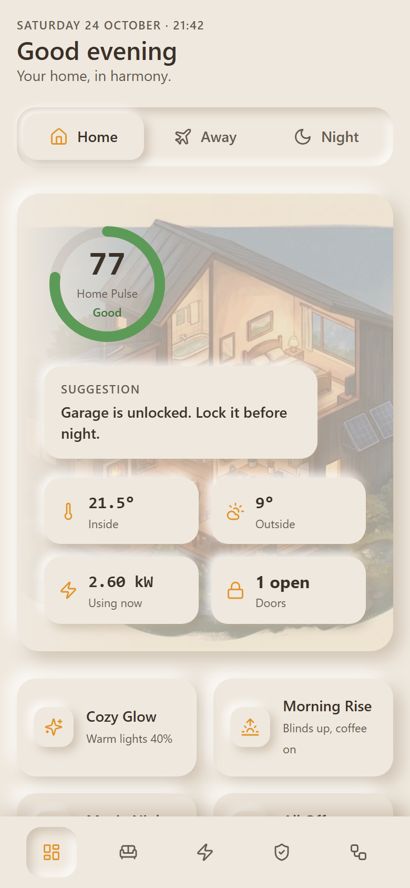

# Hearthly

Mock smart-home control dashboard (static HTML/CSS/JS, no backend).
Hero art by Gemini, copy ideas by ChatGPT, built by Claude.

Live: https://ghostaiproject.github.io/home-control/

Run locally: `python -m http.server 5173` then open http://localhost:5173

## Screenshots

Retake: `python tools/shots.py [url] [out_dir]` (needs Playwright). Also writes `sheet.jpg`, one small contact sheet of all views; review that one.
